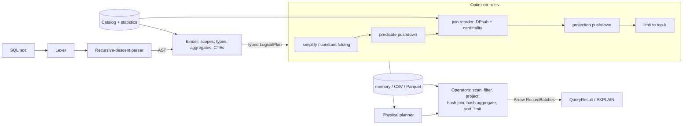

# quarry

[](https://github.com/csalekhya/quarry/actions/workflows/ci.yml)

A vectorized SQL query engine over Apache Arrow, written from scratch in Rust:
a recursive-descent SQL parser, a typed binder, a rule-based optimizer with
cost-based join reordering, and pull-based physical operators (hash join, hash
aggregate, sort, scans over memory, CSV and Parquet) that process Arrow record
batches. Every one of its 22 TPC-H-like benchmark queries, 93 targeted feature
queries and thousands of randomly generated queries return the same rows as
SQLite on identical data.

**Why.** A query engine is easiest to understand end to end when the codebase
is small enough to read: where predicate pushdown has to stop for outer joins,
how a join order is picked from statistics, what "vectorized" means for a hash
join, and how to test all of it against a reference database. quarry is meant
for that kind of study and experimentation, not as a production database.

## Features

- **SQL subset** ([docs/SQL.md](docs/SQL.md)): `SELECT [DISTINCT]`, `WHERE`,
  inner/left/cross joins (explicit and comma), `GROUP BY` (expressions,
  ordinals, aliases), `HAVING`, `ORDER BY` (ordinals, aliases, hidden
  expressions, `NULLS FIRST/LAST`), `LIMIT/OFFSET`, derived tables with column
  aliases, CTEs (`WITH`, multi-reference), `CASE`, `CAST`, `BETWEEN`, `IN`,
  `LIKE`, `IS NULL`, `EXTRACT`, `DATE` literals with `INTERVAL` arithmetic,
  `count/sum/avg/min/max` with `DISTINCT`, string functions, `coalesce`,
  `round`, and `EXPLAIN [ANALYZE] [VERBOSE]`.
- **Binder** with SQL scoping, ambiguity detection, implicit coercion
  (BIGINT/DOUBLE, string-to-DATE) and errors that name the stage and position.
- **Optimizer**: constant folding (using the runtime evaluator), boolean
  simplification, OR-factoring, predicate pushdown through projections,
  aggregates and joins, LEFT-to-INNER conversion for null-rejecting filters,
  projection pushdown, top-k, and **join reordering by estimated cardinality**
  (DPsub up to 10 relations, greedy beyond) from collected statistics.
- **Execution**: Volcano-style pull of Arrow `RecordBatch`es; chained hash
  join on Arrow row-format keys with residual filters and LEFT semantics;
  nested-loop join; hash aggregation with vectorized accumulators and DISTINCT;
  full and top-k sort; CSV and Parquet scans with column projection, pushed
  filters and Parquet row-group pruning; per-operator metrics in
  `EXPLAIN ANALYZE`.
- **Tooling**: deterministic TPC-H-like data generator (`quarry gen`), CLI
  (`quarry query`), benchmark harness, golden plan tests and a SQLite-backed
  differential fuzzer.

## Architecture



Columns are identified by plan-wide unique ids rather than names or positions,
so rewrites move expressions around without index bookkeeping; physical
planning resolves ids to batch positions once. The full design, algorithms and
complexity analysis are in [docs/ARCHITECTURE.md](docs/ARCHITECTURE.md).

| Path | Contents |
|---|---|
| `src/sql/` | lexer, AST, parser |
| `src/binder.rs` | AST to typed logical plan |
| `src/plan/` | typed expressions, logical operators, tree rewrite helpers |
| `src/optimizer/` | rules and cardinality estimation |
| `src/physical/` | expression evaluator, operators, physical planner |
| `src/catalog.rs`, `src/engine.rs` | tables + statistics, public API, EXPLAIN |
| `src/tpch.rs`, `src/main.rs` | data generator, CLI |
| `queries/tpch/` | the 22 TPC-H-like queries |
| `tests/` | differential, golden, source, error and CLI tests |

## Quickstart

Requires a Rust toolchain (1.88 or newer). No network or Docker is needed after
the dependencies are fetched.

```sh
cargo build --release
./target/release/quarry gen --sf 0.01 --out data/sf0.01 --format parquet
./target/release/quarry query --data data/sf0.01 -f queries/tpch/q03.sql
./target/release/quarry query --data data/sf0.01 "EXPLAIN ANALYZE SELECT count(*) FROM lineitem WHERE l_shipdate >= DATE '1998-01-01'"
./target/release/quarry query --data fixtures "SELECT name, salary FROM employees ORDER BY salary DESC NULLS LAST LIMIT 3"
```

`--data DIR` registers every `.csv`/`.parquet` file under its file stem;
`--table NAME=PATH` registers one file; `--disable-rule NAME` switches off an
optimizer rule; `RUST_LOG=debug` logs registration and planning times.

As a library:

```rust
use quarry::Engine;

let mut engine = Engine::new();
engine.register_parquet("lineitem", "data/sf0.01/lineitem.parquet")?;
let result = engine.sql("SELECT l_returnflag, count(*) FROM lineitem GROUP BY 1 ORDER BY 1")?;
println!("{result}");
```

`make check` runs every gate (format, clippy with warnings as errors, all tests
under coverage with an 85% line floor, doc tests). `make demo` runs the demo
below.

## Demo

Output of `make demo` (abridged to the interesting parts; the full run also
prints the Q5 physical plan and two error messages):

```text
### 3. Bundled CSV fixtures: LEFT JOIN, NULL-aware aggregates, self-join
 department  | staff | avg_salary | first_hire | location
-------------+-------+------------+------------+----------
 Engineering |     4 |     9700.0 | 2014-10-10 | Berlin
 Research    |     3 |     9000.0 | 2015-06-01 | Berlin
 Sales       |     3 |  5866.6667 | 2020-02-29 | London
 Support     |     1 |     6400.0 | 2024-01-08 | (remote)
 Legal       |     0 |       NULL | NULL       | Paris
(5 rows)

### 4. EXPLAIN: Q5's six-way comma join after predicate pushdown and join reordering
== Optimized Logical Plan ==
Sort: revenue DESC  [est_rows=5]
  Projection: n_name, sum(l_extendedprice * (1 - l_discount)) AS revenue  [est_rows=5]
    Aggregate: group=[n_name] aggs=[sum(l_extendedprice * (1.0 - l_discount)) AS sum(l_extendedprice * (1.0 - l_discount))]  [est_rows=5]
      Projection: l_extendedprice, l_discount, n_name  [est_rows=197]
        InnerJoin: on=[l_suppkey = s_suppkey, l_orderkey = o_orderkey]  [est_rows=197]
          Scan: lineitem [l_orderkey, l_suppkey, l_extendedprice, l_discount]  [est_rows=59883]
          Projection: o_orderkey, s_suppkey, n_name  [est_rows=4928]
            InnerJoin: on=[o_custkey = c_custkey]  [est_rows=4928]
              Scan: orders [o_orderkey, o_custkey, o_orderdate] filters=[o_orderdate >= DATE '1994-01-01', o_orderdate < DATE '1995-01-01']  [est_rows=4928]
              Projection: c_custkey, s_suppkey, n_name  [est_rows=1200]
                InnerJoin: on=[c_nationkey = s_nationkey]  [est_rows=1200]
                  Scan: customer [c_custkey, c_nationkey]  [est_rows=1500]
                  Projection: s_suppkey, s_nationkey, n_name  [est_rows=20]
                    InnerJoin: on=[s_nationkey = n_nationkey]  [est_rows=20]
                      Scan: supplier [s_suppkey, s_nationkey]  [est_rows=100]
                      Projection: n_nationkey, n_name  [est_rows=5]
                        InnerJoin: on=[n_regionkey = r_regionkey]  [est_rows=5]
                          Scan: nation [n_nationkey, n_name, n_regionkey]  [est_rows=25]
                          Scan: region [r_regionkey, r_name] filters=[r_name = 'ASIA']  [est_rows=1]

### 5. EXPLAIN ANALYZE: Q6 prunes Parquet row groups with pushed date filters
== Physical Plan (analyzed) ==
ProjectExec: sum(l_extendedprice * l_discount) AS revenue  [rows=1 batches=1 time=0.281ms self=0.001ms]
  HashAggregateExec: group=[] aggs=[sum(l_extendedprice * l_discount)]  [rows=1 batches=1 time=0.281ms self=0.014ms groups=1]
    ScanExec: lineitem (parquet) columns=[l_quantity, l_extendedprice, l_discount, l_shipdate] filter=[l_shipdate >= DATE '1994-01-01' AND l_shipdate < DATE '1995-01-01' AND l_discount >= 0.049999999999999996 AND l_discount <= 0.06999999999999999 AND l_quantity < 24.0] pruning_predicates=5  [rows=783 batches=2 time=0.267ms self=0.267ms rows_read=16384 row_groups=4 row_groups_pruned=3]
== Execution: 1 rows in 0.284 ms ==

### 6. Errors carry the stage and position
error: syntax error at line 1, column 51: expected an expression, found end of input
error: bind error: column 'orders.o_custkey' must appear in the GROUP BY clause or be used in an aggregate function
```

In step 4 the query was written as `FROM customer, orders, lineitem, supplier,
nation, region WHERE ...`: the binder produced five cross products, predicate
pushdown turned the WHERE equalities into join keys and the scan filters, and
the join reorderer built a right-deep plan in which the 60k-row `lineitem`
probes hash tables built from the small inputs. In step 5 the constant
`DATE '1994-01-01' + INTERVAL '1' YEAR` was folded to `DATE '1995-01-01'`
(and `0.06 - 0.01` to the IEEE double it really is), and three of the four
row groups of the date-clustered Parquet file were skipped.

## Correctness and testing

| What | Command | Result (this machine) |
|---|---|---|
| All gates | `make check` | passes: 114 tests, 94.76% line coverage (`cargo llvm-cov --summary-only`) |
| 22 TPC-H-like queries vs SQLite, SF 0.01 | `cargo test --test tpch_vs_sqlite` | 22/22 identical |
| 93 NULL-heavy and signed-zero feature queries vs SQLite (64-row batches), each also re-run with every optimizer rule disabled | `cargo test --test sql_features` | all identical |
| Random queries vs SQLite | `PROPTEST_CASES=30000 cargo test --release --test differential_fuzz` | 30,000/30,000 identical |
| Optimizer golden plans (22 queries + 7 rewrite examples) | `cargo test --test optimizer_golden` | 29 files match; no cross products in any TPC-H plan except three tiny nested-loop joins |
| Memory vs CSV vs Parquet on all 22 queries, Parquet pruning | `cargo test --test file_sources` | identical; Q6 prunes more than half the row groups |

The SQLite oracle is the bundled SQLite 3 inside `rusqlite`. Results are
compared after normalizing booleans to 0/1 and dates to ISO strings, with
floats compared at a 1e-6 relative tolerance; unordered results are sorted
canonically first. The comparison harness has a meta-test proving it catches a
wrong answer. The TPC-H-like queries need total orders in their ORDER BY to be
compared row by row, so some gained tie-breaker columns.

## Benchmarks

`cargo run --release --example bench -- --sf 0.1 --iters 5` generates SF 0.1
(599,357 lineitem rows) in memory, loads the same rows into an in-memory SQLite
database (no indexes), and runs all 22 queries. Columns: quarry (median of 5
runs after a warm-up), quarry with the `join_reorder` rule disabled (joins in
written order; queries whose written order needs a cross product are skipped),
and SQLite (1 run). Measured on an Apple-silicon laptop (aarch64) that was
running other build jobs at the same time, so differences of a few
milliseconds are noise.

| query | rows | quarry ms | quarry, no join_reorder ms | SQLite ms |
|---|---:|---:|---:|---:|
| q01 | 4 | 28.5 | 28.6 | 410.9 |
| q02 | 50 | 5.2 | cross product, skipped | 103.8 |
| q03 | 10 | 6.0 | 9.6 | 197.8 |
| q04 | 5 | 18.4 | 17.7 | 81.6 |
| q05 | 5 | 18.4 | 19.8 | 487.4 |
| q06 | 1 | 1.0 | 1.1 | 38.3 |
| q07 | 4 | 6.8 | 31.5 | 216.1 |
| q08 | 2 | 6.6 | cross product, skipped | 1630.3 |
| q09 | 175 | 42.4 | cross product, skipped | 1986.0 |
| q10 | 20 | 11.9 | 12.2 | 75.5 |
| q11 | 17 | 2.0 | 4.5 | 99.4 |
| q12 | 2 | 10.4 | 10.6 | 151.1 |
| q13 | 38 | 25.9 | 32.0 | 485.9 |
| q14 | 1 | 1.5 | 1.9 | 97.4 |
| q15 | 1 | 4.3 | 3.1 | 110.8 |
| q16 | 2662 | 4.9 | 7.9 | 34.9 |
| q17 | 1 | 23.3 | 13.8 | 2894.7 |
| q18 | 100 | 26.2 | 92.3 | 450.7 |
| q19 | 1 | 14.0 | 14.2 | not run (see note) |
| q20 | 18 | 15.8 | 9.8 | 149.7 |
| q21 | 39 | 145.1 | 161.9 | 514.6 |
| q22 | 7 | 5.4 | 5.4 | 94.0 |
| total | | 424.0 | | 10311.0 |

How to read it:

- Join reordering matters most where the written order is bad: without it Q2,
  Q8 and Q9 would contain cross products, Q18 is 3.5x slower and Q7 4.6x
  slower. Where the written order is already good the two columns match.
- Q17 and Q20 are faster with reordering off, which shows the limits of the
  estimates. In Q20 the estimator assumes 10% of parts match
  `p_name LIKE 'forest%'` (the true share is 1.6%), so it joins partsupp with
  the 56k-group aggregate before the forest filter is applied; the written
  order happens to apply the filter first (`EXPLAIN ANALYZE` shows 56,158 vs
  1,276 intermediate rows). Q17's two plans produce the same intermediate
  results and differ only in which input is hashed; that gap is within noise.
- SQLite is a row-at-a-time engine and was given no indexes, so this compares
  execution models on scan/join/aggregate-heavy queries, not "which database is
  faster" in general. SQLite does not factor the join key out of Q19's ORs and
  falls back to a nested loop over part x lineitem (about 7 s already at SF
  0.01), so the harness skips Q19 on SQLite by default (`--sqlite-skip`).
- The generator is not TPC's `dbgen` and DECIMAL is DOUBLE; none of this is a
  TPC-H result.

## Design decisions

The full list with trade-offs is in [DECISIONS.md](DECISIONS.md). Highlights:

- **Own parser and planner, Arrow kernels as building blocks.** Comparison,
  arithmetic, filter, take, lexsort and row encoding come from `arrow` 60; hash
  join, aggregation, pruning, statistics and every planning layer are here.
- **Plan-wide column ids** instead of names or positions make rewrites
  mechanical and self-joins unambiguous.
- **SQLite-compatible semantics** where engines differ (NULL ordering,
  division by zero gives NULL) so SQLite can serve as an exact oracle.
- **Constant folding through the runtime evaluator**, so plan-time and runtime
  semantics cannot drift; failing constants are left for runtime.
- **Rules run once in a fixed order** rather than to a fixed point, which keeps
  plans predictable and golden tests stable.
- **Exact statistics at registration** (one full pass, exact distinct counts)
  rather than sketches: simple and stable, at O(distinct values) memory.

## Limitations

- **SQL coverage.** No subqueries outside FROM (`IN (SELECT)`, `EXISTS`, scalar
  and correlated subqueries), no set operations, no RIGHT/FULL joins, no window
  functions, no DDL/DML. Ten of the 22 TPC-H queries had to be rewritten into
  joins against derived tables; the suite is TPC-H-*like*.
- **Types.** Five types only; DECIMAL is DOUBLE (float rounding in money sums),
  no timestamps, no intervals as values, no nested types.
- **Execution.** Single-threaded. Everything a pipeline breaker needs is held in
  memory: no spilling for large hash-join build sides, aggregations or sorts.
  A many-to-many join produces one large output batch per probe batch.
- **Optimizer.** Rules run once; cardinality estimation assumes independence
  and uniformity (no histograms; LIKE is a flat 10%, which misplans Q20),
  C_out ignores per-operator cost, and
  join reordering only applies to inner joins (outer joins are fences).
- **Semantics differences** (documented in DECISIONS.md): failed `CAST`s give
  NULL (SQLite gives 0), `CASE` evaluates every branch, `substr` with a start
  below 1 follows PostgreSQL, LIKE is case-sensitive.
- **Statistics** are gathered with a full scan at registration and are exact,
  which costs memory proportional to the number of distinct values per column;
  they are not refreshed if a file changes.
- **Benchmarks** come from one shared laptop and a synthetic generator.

## Roadmap

- Decorrelation of `IN`/`EXISTS`/scalar subqueries into semi/anti joins, so the
  original TPC-H texts run unchanged.
- Morsel-driven parallelism (partitioned hash join and aggregation).
- Spilling hash join and external sort.
- Histograms or sketches for skewed data; a cost model with build/probe costs.
- Projection of OR predicates onto single tables (Q7, Q19) and transitive
  predicate inference across equi-joins.
- DECIMAL and TIMESTAMP types.

## Line counts

`./scripts/loc.sh`:

```text
src (non-test):       10152 lines, 9009 excluding blank and comment lines
src inline tests:     1005
tests/ (integration): 1437
examples/:            194
queries/*.sql:        247
```

## License

MIT, see [LICENSE](LICENSE). Data provenance is described in [DATA.md](DATA.md).

## Maintainer

Originally developed by Sai Alekhya Chandramouli; currently maintained by Sai
Alekhya Chandramouli.

Sai is a Business Intelligence Analyst & Developer with 4+ years of experience
building BI solutions and analytical reporting workflows. The project's focus
on SQL, data processing, and query analysis aligns with that background.

- [LinkedIn](https://www.linkedin.com/in/alekhya-chandramouli/)
- [Email](mailto:alekha.chandramouli@gmail.com)