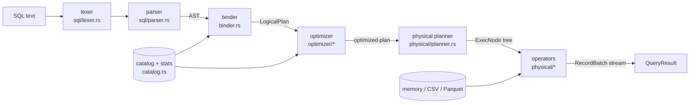

# Architecture

quarry turns a SQL string into Arrow record batches in six stages. Each stage
is a module with a narrow, typed interface, and each has its own tests.



| Module | Lines of interest |
|---|---|
| `sql/lexer.rs` | tokens with 1-based line/column positions |
| `sql/parser.rs` | recursive descent for statements, precedence climbing for expressions |
| `sql/ast.rs` | untyped syntax tree; `Display` gives canonical SQL used for default column names |
| `binder.rs` | scopes, CTE expansion, aggregate analysis, type coercion |
| `plan/expr.rs`, `plan/logical.rs` | typed expressions and relational operators, tree rewrite helpers |
| `optimizer/` | five rules plus the cardinality estimator |
| `physical/` | vectorized expression evaluator and operators |
| `catalog.rs` | table registry and ANALYZE-style statistics |
| `engine.rs` | public API, EXPLAIN rendering |
| `tpch.rs` | deterministic TPC-H-like data generator and file writers |

## 1. Parsing

The lexer folds unquoted identifiers to lower case and does not distinguish
keywords; the parser recognizes keywords by comparing unquoted identifiers
against the words it expects, and refuses a reserved word where an alias or
column name is expected. Every token keeps its position, so errors read
`syntax error at line 2, column 17: expected an expression, found end of input`.

Expressions use precedence climbing: `expr_bp(min_bp)` parses a prefix (literal,
column, `(...)`, `NOT`, `-`, `CASE`, `CAST`, `EXTRACT`, `DATE '...'`,
`INTERVAL '...'`, function call) and then repeatedly consumes infix operators
whose binding power exceeds `min_bp`. Postfix forms (`IS NULL`, `[NOT]
BETWEEN/IN/LIKE`) bind at comparison strength; `BETWEEN`'s bounds are parsed
above `AND` so `a BETWEEN 1 AND 2 AND b` groups correctly. Parsing is O(n) in
the number of tokens. The accepted grammar is in [`SQL.md`](SQL.md).

## 2. Binding

The binder walks the AST with a *scope*: the list of `(qualifier, name,
ColumnDef)` triples visible at that point. FROM items are bound left to right
and their scopes concatenated; `t.a` matches qualifier and name, a bare `a` must
match exactly one column id or it is ambiguous.

**Column identity.** Every column produced by any plan node has a `ColId` that
is unique within the query. Scans allocate fresh ids per table reference (so
`nation n1, nation n2` never collide), computed projections and aggregates
allocate new ones, and a projection that passes a column through keeps its id.
Expressions refer to columns only by id. This is what makes the optimizer
simple: moving a predicate across a projection is substitution by id, and
reordering joins never needs index arithmetic. The physical planner resolves
ids to positions once.

**CTEs** are inlined: each reference re-binds the CTE's AST in the CTE scope
that was visible at its definition, so two references (TPC-H Q15) produce
disjoint ids and can be joined. A CTE cannot see itself, so recursion is an
"unknown table" error.

**Aggregation.** If the block has GROUP BY, HAVING, or an aggregate anywhere,
aggregate calls in SELECT/HAVING/ORDER BY are replaced by placeholder
identifiers (with a qualifier containing a NUL byte, which the lexer can never
produce) that resolve to the aggregate's output column. The rewritten
expression is bound normally, then sub-expressions structurally equal to a
GROUP BY key are replaced by the key's output column, top-down so the largest
match wins. Any remaining column that is neither a key nor an aggregate output
is the classic "must appear in the GROUP BY clause" error. GROUP BY also accepts
select-list ordinals and aliases. `DISTINCT` becomes an aggregate with every
output column as a key and no aggregates.

**ORDER BY** resolves, in order: an ordinal; a select-list alias; otherwise an
expression bound in the pre-projection scope. An expression that is not in the
select list becomes a hidden projection column, sorted on, and removed by a
final projection.

**Types.** Arithmetic on BIGINT and DOUBLE promotes to DOUBLE; a VARCHAR
compared with a DATE is cast to DATE (string literals are parsed at bind time);
untyped NULL adopts the other side's type. Casts are inserted explicitly, so
every physical kernel sees operands of identical types. `BETWEEN` desugars to
two comparisons and `CASE x WHEN v` to `x = v`. `date ± INTERVAL` becomes a
`date_add[months, days]` function.

## 3. Optimization

`Optimizer::default()` runs five rules once each, in this order. `EXPLAIN
VERBOSE` prints the plan after every rule.

### 3.1 `simplify_expressions`

Bottom-up over every expression: a sub-expression with no column references is
evaluated by the runtime evaluator on a one-row batch and replaced by the
literal (if evaluation fails, say an overflow, it is left for runtime, so it
only fails if a row reaches it). Boolean identities (`x AND TRUE`, `x OR TRUE`,
`NOT NOT x`, casts to the same type) are applied, filters that fold to TRUE are
removed and filters that fold to FALSE or NULL become an empty relation.

ORs are factored: each disjunct is split into conjuncts, conjuncts common to
all disjuncts are pulled out (`(a AND b) OR (a AND c)` to `a AND (b OR c)`),
and absorption removes the OR entirely when one disjunct is just the common
part. Both identities hold in three-valued logic. TPC-H Q19 repeats its join
key `p_partkey = l_partkey` inside each of three OR branches; after factoring
the key becomes an ordinary hash-join key (and `p_size >= 1`, common to the
three `BETWEEN`s, is pushed into the part scan).

### 3.2 `predicate_pushdown`

`push(plan, predicates)` carries a list of conjuncts down the tree:

| Node | Action |
|---|---|
| Filter | split its predicate into conjuncts, continue with the input |
| Projection | substitute projected expressions for column ids, push everything |
| Sort (no fetch) | push through |
| Aggregate | conjuncts referencing only group keys (and at least one column) go below, rewritten to the key expressions; the rest stay above |
| Inner join | conjuncts over one side go to that side; `l = r` with `l` over the left and `r` over the right becomes an equi-join key; anything else is the join's residual filter. The join's own ON condition is processed the same way |
| Left join | conjuncts from above that reference only the left side go left, the rest stay above. ON-conjuncts over only the right side go right; left-only ON conditions stay in the join (they must not drop preserved rows) |
| Scan | conjuncts are attached to the scan |
| Top-k sort, Limit, Empty | barrier: predicates stay above |

Before handling a LEFT join, a WHERE predicate that is *null-rejecting* for the
right side converts it into an INNER join. A predicate is null-rejecting if it
is a strict expression over a right column (comparisons, arithmetic, LIKE, IN,
casts and non-COALESCE functions all return NULL on NULL input), or an AND
with a null-rejecting conjunct, or an OR whose branches all are. IS NULL, CASE
and COALESCE are not strict, which is why `LEFT JOIN ... WHERE r.k IS NULL`
(the anti-join in Q16 and Q22) stays a LEFT join.

Each conjunct visits each node at most once: O(nodes × conjuncts).

### 3.3 `join_reorder`

A maximal subtree of inner joins is flattened into *leaves* (inputs that are not
inner joins, each recursively optimized) and *predicates* (equi-keys and
residual filters). Each predicate gets a bitmask of the leaves it references.

*Cardinality of a subset S* is the product of its leaves' estimated rows times
the selectivity of every predicate whose mask lies inside S. It does not depend
on the order in which S was assembled, so it is computed once per subset.

*DPsub* (up to 10 leaves): iterate subsets in increasing numeric order (every
proper subset comes first); for each subset enumerate its splits (S1, S \ S1)
with S1 containing the lowest bit, keep only splits connected by a predicate,
and choose the one minimizing `cost(S1) + cost(S2) + rows(S)` (C_out, the sum
of intermediate result sizes). If the join graph is disconnected the pass is
repeated allowing cross products. Time O(3^n), space O(2^n); for n = 8 (TPC-H
Q8) that is fewer than 3^8 = 6,561 split candidates.

*Greedy* (more than 10 leaves): repeatedly merge the pair of components with
the smallest result, preferring connected pairs. O(n^3).

When the tree is materialized, the smaller input of each join becomes the right
(build) side, and every predicate is attached at the lowest join covering its
mask, as an equi-key when it has the form `left_expr = right_expr`, otherwise
as a residual filter.

*Estimates* (`optimizer/cardinality.rs`) come from catalog statistics:
`col = literal` has selectivity 1/NDV; ranges interpolate linearly between min
and max (DATE and numbers); `a = b` is 1/max(NDV(a), NDV(b)); `AND` multiplies,
`OR` is `s1 + s2 - s1·s2`, `NOT` is `1 - s`; LIKE is 0.1, IN lists k/NDV,
IS NULL the null fraction, anything else 0.25. Group-by output is the product of
key NDVs capped by input rows. LEFT joins add `left_rows × (1 - NDV(r)/NDV(l))`
NULL-extended rows (key containment) and raise the right side's null fraction,
so `IS NULL` anti-join filters are estimated sensibly. NDVs are capped by row
counts as they flow up.

### 3.4 `projection_pushdown`

Top-down with the set of column ids the parent needs: scans read only needed
columns (plus the columns their own filters use; at least one column so
`count(*)` still sees rows), unused projection items and unused aggregates are
dropped, and above each join a narrowing projection removes columns nothing
above needs (usually the join keys), so later joins move fewer arrays. A final
pass merges a column-only projection into the projection below it and drops
identity projections.

### 3.5 `limit_pushdown`

`LIMIT k OFFSET m` above a sort (possibly through projections) gives the sort a
`fetch = k + m` bound; the sort becomes a top-k (`lexsort_to_indices` with a
limit, a partial sort).

## 4. Execution model

Execution is single-threaded and pull-based (Volcano style) over Arrow
`RecordBatch`es of `batch_size` rows (8192 by default). Every operator
implements

```rust
trait Operator {
    fn next_batch(&mut self) -> Result<Option<RecordBatch>>;
    fn children(&self) -> Vec<&ExecNode>;
    fn describe(&self) -> String;
    fn extra_metrics(&self) -> Vec<(&'static str, String)>;
}
```

and is wrapped in an `ExecNode`, which skips empty batches and records output
rows, batches and inclusive wall time for `EXPLAIN ANALYZE` (self time is
inclusive time minus the children's).

Because work is done a batch at a time, interpretation overhead (virtual calls,
expression-tree walks) is paid once per batch, not once per row; the per-row
work happens inside Arrow kernels or tight loops over primitive slices. Pulling
also gives early termination for free: `LimitExec` stops asking for batches
once it has enough rows.

**Pipelines.** Scan, filter, projection, limit and the probe side of a join
stream. Hash-join build, nested-loop build, aggregation and sort are pipeline
breakers that drain their input on the first `next_batch` call.

**Expression evaluation** (`physical/expr.rs`) returns a `ColumnarValue`, either
an array or a scalar, so `col < 10` runs Arrow's comparison kernel against a
broadcast scalar without materializing a column of tens, and expressions over
constants stay scalars. Division and modulo use custom kernels (zero divisor
gives NULL), `CASE` evaluates branches and combines them with `zip` from the
last branch backwards, `IN` is an OR of equality kernels (exact three-valued
semantics), and string and date functions are tight loops over the arrays.

### Operators

| Operator | Algorithm | Time | Memory |
|---|---|---|---|
| `ScanExec` | memory: zero-copy slices; CSV: arrow-csv reader with column projection; Parquet: projection mask plus row-group pruning from min/max statistics of pushed `col <op> literal` filters; pushed filters applied per batch | O(rows read) | one batch |
| `FilterExec` | evaluate predicate, NULL counts as false, Arrow `filter` | O(n) | one batch |
| `ProjectExec` | evaluate each expression | O(n · exprs) | one batch |
| `HashJoinExec` | build: concat right input, encode keys with Arrow's row format, chained hash table (`FxHashMap<hash, first_row>` + `next: Vec<u32>`), rows with NULL keys skipped; probe: per batch, walk chains comparing encoded keys, gather with `take`; residual filter on candidates; LEFT joins emit unmatched probe rows once with NULLs. An empty build side ends an inner join without reading the probe side | O(R + L + matches) | O(R) |
| `NestedLoopJoinExec` | right side materialized; output generated in chunks of whole left rows (`batch_size / R` rows per chunk); residual filter; LEFT semantics as above | O(L · R) | O(R + chunk) |
| `HashAggregateExec` | group keys encoded with the row format, `FxHashMap<key bytes, group id>`; vectorized accumulators update flat `Vec`s by group id; DISTINCT aggregates dedupe (group, value) pairs first | O(n) expected | O(groups) (+ O(distinct pairs)) |
| `SortExec` | concat, `lexsort_to_indices` (with `limit` for top-k), `take` | O(n log n), top-k O(n log k) | O(n) |
| `LimitExec` | slice batches, stop pulling at `fetch` | O(k + skip) | one batch |

## 5. Statistics

`Engine::register_*` runs one streaming pass over the table (an implicit
ANALYZE) and records, per column: null count, min and max (numbers, dates,
strings) and the exact number of distinct values, from a set of 64-bit FxHash
values (so the NDV can undercount only on a hash collision). Sources are read
lazily afterwards: registering a CSV or Parquet file does not keep it in
memory.

## 6. Testing strategy

| Layer | Test | Oracle |
|---|---|---|
| lexer, parser, binder, expression kernels, accumulators, calendar math | unit tests in each module | hand-written expectations |
| end-to-end correctness | 22 TPC-H-like queries at SF 0.01 (`tests/tpch_vs_sqlite.rs`) | SQLite on identical data |
| NULL and signed-zero semantics, joins, grouping, ordering | 93 feature queries on NULL-heavy tables, 64-row batches (`tests/sql_features.rs`) | SQLite |
| rule safety | every feature query re-run with each optimizer rule disabled | quarry with all rules |
| random queries | proptest-driven query generator (`tests/differential_fuzz.rs`; integer expressions plus a signed-zero DOUBLE family), 300 cases per run, more with `PROPTEST_CASES` | SQLite |
| optimizer output | 29 golden EXPLAIN files (`tests/golden/`) plus structural checks (no cross products, smaller build side) | reviewed snapshots |
| sources | memory vs CSV vs Parquet on all 22 queries; row-group pruning; CSV inference | quarry in-memory |
| interfaces | error stages/positions, EXPLAIN variants, CLI end to end | expectations |

The SQLite comparison normalizes values (booleans to 0/1, dates to ISO
strings, ints and floats compared numerically with a 1e-6 relative tolerance)
and sorts rows canonically unless the query's ORDER BY is a total order. A
meta-test checks that the harness reports a deliberately wrong answer.
